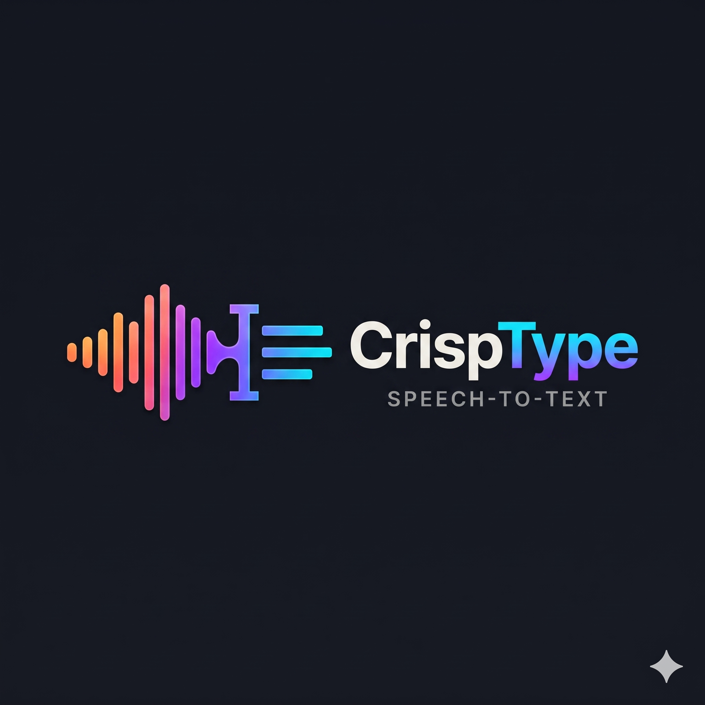

<div align="center">



# CrispType

**Ultra-lightweight, privacy-first, context-aware voice dictation for Linux, Windows 11, and Android.**

[](LICENSE)
[](.github/workflows/ci.yml)

</div>

---

## Why CrispType?

Most open-source dictation tools force your laptop to load gigabytes of local AI models into RAM and GPU memory. **CrispType separates the lightweight client (<100 MB RAM) from the AI inference server**:

- **Ultra-lightweight client:** Runs quietly in your system tray on Ubuntu/Debian Linux (`.deb` / `.AppImage`), Windows 11 (`.exe`), and Android (`.apk`). Press your global hotkey anywhere and dictate over any app.
- **Two-stage AI pipeline on your own server:**
  1. **Silero VAD (Native C++17 / ONNX)** strips silence, fan noise, and breathing pauses.
  2. **NVIDIA Parakeet TDT / Faster-Whisper / SeamlessM4T v2** converts speech to accurate raw text.
  3. **Llama 3.2 (Layer 2 Context Polisher)** removes verbal fillers (`um`, `uh`, `you know`), resolves spoken self-corrections (*"Thursday, actually no Friday"* → *"Friday"*), applies your personal dictionary, and adapts tone to the active app (formal in Gmail/Outlook, casual in Slack/Teams, very casual in WhatsApp/Telegram).
- **Live dictation productivity insights:** Tracks words dictated, filler words removed, and real time saved compared to an average **42–46 WPM** typing baseline.

---

## Architecture

```text
┌─────────────────────────────────────────────────────────────────────────┐
│  CrispType Lightweight Client (<100 MB RAM · Tauri v2 + React + TS)     │
│  Linux (.deb / .AppImage) · Windows 11 (.exe) · Android (.apk)          │
│                                                                         │
│  Global Hotkey -> 16 kHz Int16 PCM (32 ms frames) -> WSS + API Key      │
│  Auto-Paste (X11 / Wayland / Win32) with automatic clipboard fallback   │
└───────────────────────────────────┬─────────────────────────────────────┘
                                    │ WSS / HTTPS (Zero URL-key leakage)
                                    ▼
┌─────────────────────────────────────────────────────────────────────────┐
│  CrispType Self-Hosted Backend (FastAPI + Native C++17 Silero VAD)      │
│                                                                         │
│  [Auth + Rate Limit] -> [Silero VAD] -> [Parakeet / Whisper STT]        │
│                                              │                          │
│                                              ▼                          │
│                     [Llama 3.2 Layer 2 Refiner (<transcript> isolated)] │
│                                              │                          │
│                     Zero-Retention Memory Wipe -> Polished Text JSON    │
└─────────────────────────────────────────────────────────────────────────┘
```

---

## Privacy & Security Guarantees

- **Zero Audio Retention:** Incoming PCM streams are processed strictly in RAM and zeroed/cleared inside `finally` blocks. Uploaded audio containers are decoded via allowlisted extensions and deleted immediately in `finally`.
- **No Transcript Logging:** Production servers never log raw or formatted user speech.
- **Prompt-Injection Isolation:** Raw STT transcripts are wrapped inside strict `<transcript>...</transcript>` delimiters so spoken commands cannot override Layer 2 formatting rules.
- **API Key Protection:** Clients authenticate via `Authorization: Bearer <API_KEY>` (HTTP) or encrypted-over-WSS JSON handshake frames (never in URL query strings).
- **Local-Only History:** Dictation history, personal dictionary, and WPM insights remain strictly on your device.

---

## Quick Start: Self-Host the Backend (1 Command)

Clone the repository onto any Ubuntu/Debian Linux machine, GPU box, or cloud VM and run:

```bash
git clone https://github.com/<your-org>/crisptype.git
cd crisptype/backend
bash setup.sh
```

`setup.sh` automatically:
1. Installs `ffmpeg`, `cmake`, and Python virtual environment tools.
2. Compiles the native C++17 Silero VAD library (`libsilero_vad.so`) and downloads `silero_vad.onnx`.
3. Generates a cryptographically random `CRISPTYPE_API_KEY` inside `backend/.env`.
4. Starts the server on port `8000` and prints your ready-to-paste **Server URL** and **API Key**.

### Optional: Use NVIDIA Parakeet + Llama 3.2 (Ollama)

```bash
# Enable NVIDIA Parakeet TDT (ONNX Runtime)
CRISPTYPE_ASR_ENGINE=parakeet bash setup.sh
```

To enable Layer 2 Llama 3.2 polishing, edit `backend/.env`:
```env
CRISPTYPE_LLM_URL=http://127.0.0.1:11434/v1
CRISPTYPE_LLM_MODEL=llama3.2:3b
```

### Or Run with Docker Compose

```bash
cd backend
cp .env.example .env
# Set a strong CRISPTYPE_API_KEY in .env
docker compose up -d --build
```

---

## Quick Start: Install & Connect the Client

1. Download the latest installer from **GitHub Releases**:
   - **Ubuntu / Debian Linux:** `CrispType_*.deb` or portable `CrispType_*.AppImage`
   - **Windows 11:** `CrispType_*_x64-setup.exe`
   - **Android:** `CrispType_*.apk`
2. Open **CrispType → Settings → Server**, paste your **Server URL** and **API Key**, and click **Connect**.
3. Press your global hotkey (default **`Ctrl + Alt + Space`**) from any app to start dictating!

### Linux Wayland & X11 Auto-Paste Notes
- **X11:** Uses `xclip` + `xdotool` (declared automatically in `.deb` dependencies).
- **Wayland:** Uses `wl-clipboard` (`wl-copy`) + `wtype` (declared in `.deb` recommends). If your compositor restricts synthetic paste or active-window inspection, CrispType falls back gracefully to clipboard copy (`Copied to clipboard — press Ctrl+V to paste`) and `"General"` formatting without errors.

---

## Build Locally From Source

### Web / Node.js Dev Server
```bash
npm install
npm run dev
```

### Linux Desktop Packages (`.deb` + `.AppImage`)
```bash
sudo apt install -y libwebkit2gtk-4.1-dev libayatana-appindicator3-dev librsvg2-dev patchelf xclip xdotool
npm install
npx @tauri-apps/cli@^2 build --bundles deb,appimage
```

### Run Tests & Checks
```bash
npm run lint
npm test
npm run build
```

---

## Roadmap

- [x] Lightweight Tauri v2 client with system tray, auto-start, and always-on-top floating popup
- [x] Native C++17 Silero VAD + NVIDIA Parakeet / Faster-Whisper + Llama 3.2 Layer 2 pipeline
- [x] Automated GitHub Actions releases for `.deb`, `.AppImage`, `.exe`, and `.apk`
- [ ] Optional **CrispType Cloud** hosted mode (zero server setup for non-technical users, using the same `ConnectionProviderConfig` interface)

---

## License

Released under the [MIT License](LICENSE). See [CONTRIBUTING.md](CONTRIBUTING.md) and [SECURITY.md](SECURITY.md) for contributor and security guidelines.
